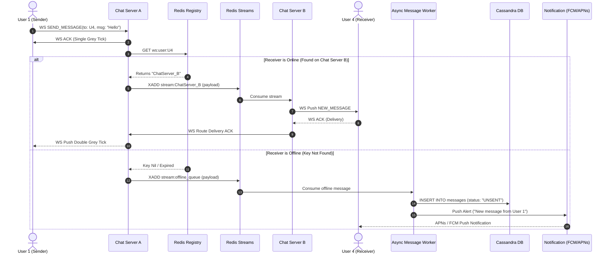

# System Design 08: Design Chat Application (WhatsApp / Facebook Messenger)

> **Source**: [Interview with Bunny - Episode 8](https://www.youtube.com/watch?v=3HXFy_7M12E)  
> **Companion Reference**: [interviewwithbunny.com/systemdesign/08](https://www.interviewwithbunny.com/systemdesign/08)  
> **Topic**: Designing a Highly Scalable, Real-Time Messaging Platform (WhatsApp / Messenger / Telegram)

---

## 1. Step 1: Requirements Gathering & Estimations

### 1.1 Context & Problem Scope
Real-time chat platforms require orchestrating hundreds of millions of concurrent bidirectional connections while guaranteeing sub-second message delivery, reliable receipt tracking (sent, delivered, read), offline queuing, group messaging fanout, and media streaming.

```
[ Sender (User 1) ]                                      [ Receiver (User 4) ]
        │                                                        │
        │ 1. ws.send(msg)                                        │ 4. ws.push(msg)
        ▼                                                        ▼
┌──────────────┐     2. Channel Route      ┌──────────────┐     ┌──────────────┐
│ Chat Server1 │──────────────────────────▶│ Chat Server2 │────▶│ Active Client│
└──────────────┘    (via Redis Streams)    └──────────────┘     └──────────────┘
        │                                                              ▲
        │ (If Offline)                                                 │
        ▼                                                              │
┌──────────────┐          3. APNs / FCM Push Notification              │
│ Cassandra DB │───────────────────────────────────────────────────────┘
│ (Store & Fwd)│
└──────────────┘
```

---

### 1.2 Functional Requirements (FR)
1. **User Authentication & Onboarding**: Phone number OTP verification (WhatsApp) or email/password authentication (Messenger).
2. **One-to-One Real-Time Messaging**: Users can send and receive text messages to/from 1-to-1 contacts in near real time.
3. **Group Messaging**: Users can create groups, invite/remove members, and broadcast messages to groups (up to 1,024 members).
4. **Delivery Receipts & Message Status**:
   - **Single Grey Tick**: Message successfully received by the chat server (`SENT`).
   - **Double Grey Tick**: Message delivered to recipient’s device (`DELIVERED`).
   - **Double Blue Tick**: Recipient has opened/read the message (`READ`).
5. **Media Sharing**: Support image and video attachments with optimized thumbnail generation.
6. **Chat History & Lazy Loading**: Users can scroll back through past message history seamlessly using infinite scroll (cursor-based pagination).
7. **User Presence & Last Seen**: Real-time indication of online status and last seen timestamp.

---

### 1.3 Non-Functional Requirements (NFR)
1. **Ultra-Low Latency**: End-to-end message transmission latency must be $< 300\text{ms}$ under normal network conditions.
2. **High Availability (99.99%)**: System prioritizes availability over strong consistency (**AP in CAP theorem**). If a message takes an extra 100ms to synchronize across replicas, availability is preserved.
3. **Zero Message Loss (100% Reliability)**: Messages must never be dropped. If a recipient is offline, the system must reliably persist and deliver upon reconnection.
4. **Massive Scale**: Support $1\text{ Billion}$ total users with tens of millions of concurrent active WebSocket connections.
5. **Data Privacy & Security**: End-to-End Encryption (E2EE) using the Signal Protocol (keys kept client-side; server acts strictly as an encrypted ciphertext relay).

---

### 1.4 Capacity Estimations (Back-of-the-Envelope Math)

#### Traffic Estimations
- **Total Registered Users**: $1\text{ Billion}$ users.
- **Daily Active Users (DAU)**: $500\text{ Million}$ DAU.
- **Messages sent per user/day**: 100 messages/day.
- **Total Daily Messages**:
  $$\text{Daily Messages} = 500\text{M} \times 100 = 50\text{ Billion to } 100\text{ Billion messages/day}$$
- **Average Write QPS**:
  $$\text{Average QPS} = \frac{100,000,000,000}{86,400} \approx 1,160,000\text{ messages/sec}$$
- **Peak Write QPS**: $2.5\times \text{ to } 3\times \text{ average} \approx 3,000,000\text{ messages/sec}$.

#### Storage Estimations (Per Day & Over 5 Years)
- **Average message payload**:
  - Text length: 100 characters ($\approx 100\text{ bytes}$)
  - Metadata (`chat_id`, `message_id`, timestamps, user IDs, ticks): $\approx 200\text{ bytes}$
  - Weighted average accounting for media URLs: $\approx 1\text{ KB per message}$.
- **Daily Message Storage**:
  $$\text{Storage/Day} = 100\text{ Billion} \times 1\text{ KB} = 100\text{ TB / day}$$
- **WhatsApp Client-Storage Optimization**: WhatsApp stores messages locally on user devices (SQLite) and deletes messages from servers once delivered. Assuming $10\%$ unread/transient queue retention on server:
  $$\text{Active Server Storage Working Set} \approx 10\text{ TB - } 20\text{ TB}$$

#### Bandwidth Estimations
- **Ingress Bandwidth**:
  $$\text{Ingress} = 1,160,000\text{ msg/sec} \times 1\text{ KB} \approx 1.16\text{ GB/sec} \approx 9.28\text{ Gbps}$$
- **Egress Bandwidth** (accounting for group fanout of average $3\times$):
  $$\text{Egress} \approx 3 \times 1.16\text{ GB/sec} \approx 3.48\text{ GB/sec} \approx 27.8\text{ Gbps}$$

---

## 2. Step 2: Identification of Core Entities

```
+--------------------+        +--------------------+        +--------------------+
|        User        |        |       Group        |        |    GroupMember     |
+--------------------+        +--------------------+        +--------------------+
| id (UUID, PK)      |        | id (UUID, PK)      | 1    * | id (BIGINT, PK)    |
| phone_number (VAR) |        | name (VARCHAR)     |<------>| group_id (UUID, FK)|
| username (VARCHAR) |        | description (TEXT) |        | user_id (UUID, FK) |
| status (VARCHAR)   |        | avatar_url (VAR)   |        | role (ADMIN/MEMBER)|
| last_seen (TIME)   |        | created_by (UUID)  |        | joined_at (TIME)   |
| created_at (TIME)  |        | created_at (TIME)  |        +--------------------+
+--------------------+        +--------------------+
         │
         │ 1
         │
         │ *
+--------------------+        +--------------------+
|      Message       |        | WebSocketRegistry  | (In Redis)
+--------------------+        +--------------------+
| message_id (UUID)  |        | user_id (UUID, PK) |
| chat_id (UUID)     |        | server_id (VARCHAR)|
| sender_id (UUID)   |        | connection_id (VAR)|
| receiver_id (UUID) |        | heartbeat_at (TIME)|
| group_id (UUID)    |        | ttl (INT, EXPIRE)  |
| content (TEXT)     |        +--------------------+
| type (TEXT/MEDIA)  |
| media_url (TEXT)   |
| status (SENT/DELV) |
| created_at (TIME)  |
+--------------------+
```

---

## 3. Step 3: API Design (Public REST & WebSocket Contracts)

### 3.1 Authentication & User Onboarding (REST)
```http
POST /api/v1/auth/register
Content-Type: application/json

Request Body:
{
  "phone_number": "+14155552671",
  "username": "bunny_coder",
  "client_public_key": "MIIBIjANBgkqhkiG9w0BAQEFAAOCAQ8AMIIBCgKCAQEA..."
}

Response: 200 OK
{
  "user_id": "u-49129031",
  "auth_token": "jwt_header.payload.signature",
  "expires_in": 2592000
}
```

---

### 3.2 WebSocket Handshake & Bidirectional Framing
WebSocket connections begin with a standard HTTP `101 Switching Protocols` handshake.

#### Initial HTTP Upgrade Request:
```http
GET /ws/v1/chat HTTP/1.1
Host: ws.whatsapp.com
Upgrade: websocket
Connection: Upgrade
Sec-WebSocket-Key: dGhlIHNhbXBsZSBub25jZQ==
Sec-WebSocket-Version: 13
Authorization: Bearer <jwt_auth_token>

Response: HTTP/1.1 101 Switching Protocols
Upgrade: websocket
Connection: Upgrade
Sec-WebSocket-Accept: s3pPLMBiTxaQ9kYGzzhZRbK+xOo=
```

#### WebSocket Frame Protocols (Full Duplex JSON/Protobuf)

##### 1. Send Message (Client -> Chat Server)
```json
{
  "action": "SEND_MESSAGE",
  "message_id": "msg-88129-uuid",
  "chat_id": "chat-4410",
  "recipient_id": "u-7712",
  "type": "TEXT",
  "content": "Hey Bunny, let's review the low-level design!",
  "timestamp": 1729253400000
}
```

##### 2. Server Acknowledgment to Sender (`SINGLE_TICK`)
```json
{
  "event": "MESSAGE_SENT_ACK",
  "message_id": "msg-88129-uuid",
  "chat_id": "chat-4410",
  "status": "SENT",
  "server_timestamp": 1729253400120
}
```

##### 3. Delivery Push to Recipient (`DOUBLE_TICK`)
```json
{
  "event": "NEW_MESSAGE",
  "message_id": "msg-88129-uuid",
  "chat_id": "chat-4410",
  "sender_id": "u-49129031",
  "type": "TEXT",
  "content": "Hey Bunny, let's review the low-level design!",
  "timestamp": 1729253400000
}
```

##### 4. Read Receipt from Recipient (`BLUE_TICK`)
```json
{
  "action": "MESSAGE_READ_ACK",
  "message_id": "msg-88129-uuid",
  "chat_id": "chat-4410",
  "reader_id": "u-7712",
  "read_timestamp": 1729253415000
}
```

---

### 3.3 Media Attachment Upload (REST via S3 Pre-signed URL)
Media files are never pumped through WebSocket TCP pipes directly; they use high-speed chunked HTTP uploads to object storage.

```http
POST /api/v1/media/upload
Authorization: Bearer <jwt>
Content-Type: application/json

Request Body:
{
  "file_name": "system_design_diagram.png",
  "file_size_bytes": 2048576,
  "mime_type": "image/png",
  "checksum_sha256": "e3b0c44298fc1c149afbf4c8996fb92427ae41e4649b934ca495991b7852b855"
}

Response: 200 OK
{
  "upload_url": "https://s3.amazonaws.com/whatsapp-media-bucket/uploads/msg-88129.png?AWSAccessKeyId=...",
  "media_url": "https://cdn.whatsapp.com/media/uploads/msg-88129.png",
  "thumbnail_url": "https://cdn.whatsapp.com/media/thumbs/msg-88129.png",
  "expires_in_seconds": 900
}
```

---

### 3.4 Chat History Lazy-Loading (Cursor Pagination)
```http
GET /api/v1/chats/{chat_id}/messages?limit=50&before_cursor=eyJ0aW1lc3RhbXAiOjE3MjkyNTM0MDAwMDB9
Authorization: Bearer <jwt>

Response: 200 OK
{
  "messages": [
    {
      "message_id": "msg-88128",
      "sender_id": "u-7712",
      "content": "Sure, send over the link.",
      "type": "TEXT",
      "status": "READ",
      "timestamp": 1729253380000
    }
  ],
  "next_cursor": "eyJ0aW1lc3RhbXAiOjE3MjkyNTMzODAwMDB9",
  "has_more": true
}
```

---

## 4. Step 4: High-Level Architecture


*Figure 4.1: High-Level Architecture Diagram (Source: [Interview with Bunny - System Design 08](https://www.interviewwithbunny.com/systemdesign/08))*

### Component Interaction Topology
```
[ Mobile / Web Clients ]
         │
         ├─────────────────────────────────────────────┐
         │ (HTTP REST: Auth, Media, History)           │ (Persistent WebSockets)
         ▼                                             ▼
┌─────────────────────────────────┐       ┌─────────────────────────────────┐
│     REST API Gateway / LB       │       │   Dedicated WebSocket Gateway   │
│  (Auth, Rate Limiting, Routers) │       │ (TLS Offload, Sticky WS Proxy)  │
└─────────────────────────────────┘       └─────────────────────────────────┘
         │               │                                 │
         │               ▼                                 ▼
         │      ┌──────────────────┐              ┌──────────────────┐
         │      │  Media Service   │              │   Chat Service   │
         │      │ (S3 Pre-signed)  │              │ (WebSocket Pods) │
         │      └────────┬─────────┘              └────────┬─────────┘
         │               │                                 │
         ▼               ▼                                 ▼
┌──────────────────┐ ┌─────────────┐             ┌────────────────────┐
│   User Service   │ │ Blob Store  │             │ Redis WS Registry  │
│ (Postgres UserDB)│ │ (Amazon S3) │             │(User -> Server Map)│
└──────────────────┘ └──────┬──────┘             └────────────────────┘
                            │                              │
                            ▼                              ▼
                     ┌─────────────┐             ┌────────────────────┐
                     │ CloudFront  │             │   Redis Streams    │
                     │  Edge CDN   │             │ (Channel Routing)  │
                     └─────────────┘             └─────────┬──────────┘
                                                           │
                     ┌─────────────────────────────────────┴──────────────────┐
                     │                                                        │
                     ▼                                                        ▼
         ┌───────────────────────┐                                ┌───────────────────────┐
         │ Async Message Worker  │                                │ Notification Service  │
         │   (Message Service)   │                                │  (FCM / APNs Gateway) │
         └───────────┬───────────┘                                └───────────────────────┘
                     │                                                        │
                     ▼                                                        ▼
         ┌───────────────────────┐                                [ Offline Mobile Devices]
         │ Apache Cassandra DB   │
         │ (Message & Chat Store)│
         └───────────┬───────────┘
                     │ (CDC Pipeline / Debezium)
                     ▼
         ┌───────────────────────┐
         │ Elasticsearch Cluster │
         │ (Keyword Message Srch)│
         └───────────────────────┘
```

---

## 5. Step 5: Low-Level Design & Deep Dives

---

### 5.1 Deep Dive 1: Connection Protocol Trade-Offs (Bunny's 4 Approaches)

Bunny details the four primary client-server communication paradigms and explains why WebSockets are the only viable choice for high-scale chat:

```
┌─────────────────────────────────────────────────────────────────────────────┐
│ 1. HTTP Polling: Client sends GET every 2s -> 99% empty responses -> WASTEFUL│
│ 2. Long Polling: Client opens HTTP; server holds 30s -> High timeout churn  │
│ 3. Server-Sent Events (SSE): Server pushes to client, but UNIDIRECTIONAL     │
│ 4. WebSockets: Full-duplex, persistent TCP pipe, sub-millisecond framing    │
└─────────────────────────────────────────────────────────────────────────────┘
```

1. **HTTP Short Polling**:
   - Client sends `GET /messages` every 2 seconds.
   - **Why it fails**: $99\%$ of requests return HTTP 200 with empty arrays, creating catastrophic server CPU and network bandwidth waste at 1 billion users ($500\text{M requests/sec}$ of empty pings).
2. **HTTP Long Polling**:
   - Client opens connection; server holds it open until a message arrives or a 30-second timeout occurs.
   - **Why it fails**: When friends talk intermittently, connections constantly expire and reconnect, inducing heavy TCP handshake and TLS renegotiation churn.
3. **Server-Sent Events (SSE)**:
   - Server pushes downstream events over a single long-lived HTTP connection.
   - **Why it falls short**: SSE is strictly **unidirectional** (Server $\to$ Client). Sending a reply still requires an independent HTTP `POST`, doubling the connection overhead.
4. **WebSockets (Chosen Architecture)**:
   - Upgrades standard HTTP/1.1 to a full-duplex TCP socket.
   - **Why it wins**: Minimal frame overhead (only 2 to 10 bytes header vs 500+ bytes for HTTP headers); enables simultaneous bidirectional transmission of messages, typing indicators, and ticks with sub-millisecond packet overhead.

---

### 5.2 Deep Dive 2: WebSocket Connection Lifecycle & The Redis Registry

Because WebSockets are stateful, maintaining $50\text{ Million}$ active connections across hundreds of stateless chat server pods requires an in-memory **WebSocket Registry**.

```
[ User 1 ] ──▶ (WS Conn 1) ──▶ [ Chat Server A ]
                                      │
                                      ▼ (Register User 1)
                           ┌───────────────────────┐
                           │   Redis WS Registry   │
                           │ User 1 -> Server A    │
                           │ User 4 -> Server B    │
                           └───────────────────────┘
                                      ▲
                                      │ (Register User 4)
[ User 4 ] ──▶ (WS Conn 2) ──▶ [ Chat Server B ]
```

#### Connection Setup Sequence:
1. User 1 boots the app and sends an HTTP Upgrade request to the **WebSocket Gateway**.
2. The Gateway authenticates the JWT and assigns the connection to an under-loaded **Chat Service Pod (e.g., `ChatServer_A`)**.
3. `ChatServer_A` writes the mapping to **Redis Cluster** with a $60\text{-second TTL}$:
   ```bash
   SET ws:user:u-49129031 "ChatServer_A:port_8080" EX 60
   ```
4. **Heartbeat Protocol**: Client sends a lightweight ping frame every 30 seconds. On receipt, `ChatServer_A` refreshes the TTL in Redis (`EXPIRE ws:user:u-49129031 60`).
5. **Connection Teardown / Crash**: If the user loses cellular signal or the pod crashes, the key expires automatically, preventing routing to dead sockets.

---

### 5.3 Deep Dive 3: Real-Time Message Routing Engine (Online vs. Offline)

When User 1 sends a message to User 4:



#### Why Redis Streams over Apache Kafka for Chat Routing (Bunny's Key Insight)
Bunny explicitly chooses **Redis Streams** for the live chat inter-server bus:
- **Ultra-Low In-Memory Latency**: Redis Streams operates purely in RAM with sub-millisecond dispatch time ($< 1\text{ms}$), whereas Kafka introduces OS page-cache flushes and broker batching delays ($10\text{ms} - 30\text{ms}$).
- **Lightweight Ephemeral Channels**: In a chat cluster, each server pod subscribes to its own dynamic stream/channel. Spin-up and tear-down of streams in Redis has zero partition rebalancing penalty compared to Kafka partition reassignment.
- **Role Separation**: Redis Streams acts as the live delivery bus; Kafka is reserved for offline post-processing, analytics, and Elasticsearch CDC pipelines.

---

### 5.4 Deep Dive 4: Group Chat Architecture & Fanout Strategy

Group messaging introduces the fanout problem. When a member posts a message to a group of 500 people, does the system fan out at the client or the server?

```
                      [ User 1 (Posts to Group G) ]
                                    │
                                    ▼
                          ┌──────────────────┐
                          │   Chat Server    │
                          └─────────┬────────┘
                                    │ 1. Query Group Members
                                    ▼
                          ┌──────────────────┐
                          │  Group Service   │ (Cache: Redis Set)
                          └─────────┬────────┘
                                    │ 2. Returns 500 User IDs
                                    ▼
       ┌────────────────────────────┼────────────────────────────┐
       ▼                            ▼                            ▼
[ Member 1 (Online) ]      [ Member 2 (Online) ]      [ Member 3 (Offline) ]
Push via WebSocket         Push via WebSocket         Write to Cassandra
(ChatServer A)             (ChatServer B)             + FCM Push Notification
```

#### Fan-out on Write vs Fan-out on Read:
- **WhatsApp utilizes Server-Side Fan-out on Write**:
  1. User 1 sends `SEND_MESSAGE(group_id: "g-992")`.
  2. Chat Server contacts `GroupService` (backed by a Redis Set of member IDs).
  3. The Chat Server iterates over all 500 members:
     - For active members, it dispatches to their respective server channels.
     - For inactive members, it persists the record in Cassandra marked `UNSENT` and triggers push notifications.
- **Why Server Fan-out on Write is Mandatory**:
  - In WhatsApp, every group member has independent delivery and read tracking (you can swipe left on any sent group message to see the exact list of who has received and read it).
  - Client-side fanout would require the sender's mobile phone to upload 500 redundant copies over weak cellular uplink, draining battery and mobile bandwidth.

---

### 5.5 Deep Dive 5: Database Choice & Partitioning Strategy

#### Why Apache Cassandra / ScyllaDB for Message Storage
Bunny highlights that the chat messaging database is massively **write-heavy**:
- $100\text{ Billion writes/day}$ vs read queries which only occur upon history scroll or offline catch-up.
- **Cassandra's LSM-Tree Architecture**: Cassandra performs sequential disk writes to CommitLog and MemTable, delivering near-constant $O(1)$ write throughput without random disk seeks.
- **Horizontal Linear Scaling**: Masterless distributed peer-to-peer ring architecture with zero single point of failure.

#### Cassandra Table Schema (Optimized for Query Access Pattern)
```sql
CREATE KEYSPACE whatsapp_chat 
WITH replication = {'class': 'NetworkTopologyStrategy', 'us-east': 3, 'us-west': 3};

CREATE TABLE whatsapp_chat.messages (
    chat_id UUID,                     -- Partition Key: Groups messages of the same conversation
    message_id TIMEUUID,             -- Clustering Key 1: Generates chronological ordering (Desc)
    sender_id UUID,
    receiver_id UUID,
    group_id UUID,
    message_type VARCHAR,            -- 'TEXT', 'IMAGE', 'VIDEO', 'AUDIO'
    content TEXT,                    -- Encrypted ciphertext or media URL
    delivery_status VARCHAR,         -- 'SENT', 'DELIVERED', 'READ'
    created_at TIMESTAMP,
    PRIMARY KEY ((chat_id), message_id)
) WITH CLUSTERING ORDER BY (message_id DESC);

-- Secondary lookup table for offline message catch-up
CREATE TABLE whatsapp_chat.undelivered_messages (
    recipient_id UUID,
    message_id TIMEUUID,
    chat_id UUID,
    PRIMARY KEY ((recipient_id), message_id)
) WITH CLUSTERING ORDER BY (message_id ASC);
```

> **Why `(chat_id)` as Partition Key**:  
> All messages for a given chat reside on the exact same physical node shard. Querying the latest 50 messages executes as a sequential single-partition range scan (`SELECT * FROM messages WHERE chat_id = ? LIMIT 50`), completing in $< 5\text{ms}$.

---

### 5.6 Deep Dive 6: Media Streaming Pipeline & Edge CDN

Sending large video or image payloads over a duplex WebSocket socket clogs the TCP receive window and starves real-time text frames.

```
[ Sender App ]                                           [ Receiver App ]
      │                                                         │
      │ 1. Upload Full Image                                    │ 5. Download via CDN
      ▼                                                         ▼
┌─────────────────┐       3. WS Send Metadata URL        ┌──────────────┐
│  S3 Blob Store  │─────────────────────────────────────▶│ Edge CDN     │
└────────┬────────┘                                      └──────────────┘
         │
         │ 2. Async Lambda Trigger
         ▼
┌─────────────────────────┐
│ Media Transcoder Worker │
│ • Compress 1080p -> 480p│
│ • Generate BlurHash     │
└─────────────────────────┘
```

1. **Client-side Pre-compression**: Image is resized and compressed locally on the phone before transmission.
2. **Pre-signed S3 Upload**: Client uploads directly to S3 via HTTPS multi-part upload, bypassing chat servers.
3. **Thumbnail & BlurHash Generation**: Server computes a tiny 30-byte **BlurHash string**.
4. **WebSocket Metadata Dispatch**: The sender transmits the tiny payload over the WebSocket:
   ```json
   {
     "type": "IMAGE",
     "media_url": "https://cdn.whatsapp.com/media/2026/img_9912.jpg",
     "thumbnail_blurhash": "LEHLk~WB2yk8pyo0adR*.7kCMdnj",
     "file_size": 142050
   }
   ```
5. **Instant Visual Feedback**: Recipient immediately renders the blurred image placeholder from the inline BlurHash, downloading the full image from the nearest CloudFront CDN edge node in the background.

---

### 5.7 Deep Dive 7: WhatsApp Local Store-and-Forward vs Messenger Cloud Model

Bunny addresses the classic interview question: *"Does WhatsApp store your chat history forever in their database?"*

| Dimension | WhatsApp Architecture | Facebook Messenger / Telegram |
| :--- | :--- | :--- |
| **Storage Model** | **Store-and-Forward (Ephemeral Backend)** | **Permanent Cloud Sync** |
| **Server Persistence** | Messages deleted from server immediately upon `DELIVERED` status acknowledgment. | Messages persisted indefinitely in server database clusters. |
| **Primary Data Store** | **Client Device**: Embedded SQLite DB encrypted with SQLCipher. | **Server-side**: Massive distributed database (Cassandra / HBase). |
| **Chat Restoration** | Backed up to Google Drive (Android) or iCloud (iOS). | Synced automatically across multiple browser tabs and devices in real time. |
| **Infrastructure Cost** | **Significantly lower server storage footprint** ($90\%$ disk reduction). | Massive multi-petabyte database clusters and active replication costs. |

---

## 6. Common Interview Follow-Ups & Cross-Questions (Deep Dive)


### Q1: How do you ensure messages are delivered even when the recipient is offline?

Multi-layer offline message handling:

- **Point 1**: Detection - when sending message, check Redis websocket_registry for recipient's connection_id, if null recipient is offline,

- **Redis Stream queueing - write message to Redis Stream XADD stream**:
  user:{recipient_id}:messages with message data, stream persists until user comes online,

- **Point 3**: Cassandra persistence - simultaneously write message to Cassandra for durability (Redis Stream is cache, Cassandra is source of truth),

- **Point 4**: Push notification - trigger FCM/APNS notification 'New message from {sender}',

- **On reconnect - when recipient connects WebSocket, service executes XREAD stream**:
  user:{recipient_id}:messages 0 to fetch all queued messages, delivers via WebSocket, client acknowledges, service deletes from stream XDEL,

- **Fallback - if messages in stream >7 days old (expired), retrieve from Cassandra. Example**:
  User A sends to offline User B → message stored in Cassandra + Redis Stream + push sent → B comes online after 1 hour → B receives 15 queued messages → stream cleared → B now receives new messages in real-time.

---

### Q2: How do you implement read receipts and delivery status at scale?

Event-driven status tracking:

- **Point 1**: Sent status - when message written to Cassandra, update status='sent', send single tick to sender via WebSocket,

- **Delivered status - when message delivered to recipient (either via WebSocket if online, or written to Redis Stream if offline), update message status='delivered' in Cassandra, send double tick to sender via WebSocket event {message_id, status**:
  'delivered', delivered_at},

- **Point 3**: Read status - when recipient's app displays message (onVisible/onScroll event), client sends POST /v1/messages/{message_id}/read → service updates status='read' → sends blue tick to sender,

- **Group read receipts - for groups, maintain map in Cassandra read_status**:
  {message_id → {user2: {status: 'read', read_at}, user3: {status: 'delivered'}}}, query to show 'Read by 5 of 10 members',

- **Optimization - batch read receipts**:
  instead of sending API call for each message, batch 10 message_ids in single request. Scaling: 1B messages/day × 3 status updates (sent, delivered, read) = 3B writes/day. Cassandra handles with partition by message_id, lightweight transactions for idempotency.

---

### Q3: What happens if a WebSocket connection drops in the middle of sending a message?

Client-side retry with idempotency:

- **Point 1**: Client generates - client_message_id (UUID) before sending message,

- **Send attempt - client sends via WebSocket {type**:
  'message', client_message_id, receiver_id, content},

- **Acknowledgment wait - client waits for server ACK {client_message_id, server_message_id, status**:
  'sent'},

- **Point 4**: Connection drops - if no ACK within 5s, client assumes failure,

- **Point 5**: Reconnection - WebSocket reconnects with exponential backoff (1s, 2s, 4s, 8s),

- **Point 6**: Retry logic - client resends message with same client_message_id,

- **Point 7**: Server deduplication - server checks if message with client_message_id already exists in Cassandra (lightweight transaction or SELECT before INSERT), if exists returns existing server_message_id without re-inserting,

- **Client reconciliation - client updates local DB mapping client_message_id → server_message_id. Edge case**:
  message sent but ACK lost due to network → client retries → server detects duplicate → returns success → client updates UI with server_message_id. Result: at-least-once delivery, no lost messages, handled client-side deduplication using client_message_id + server_message_id mapping.

---

### Q4: How do you handle last seen and online status efficiently?

Heartbeat-based presence system:

- **Online detection - when user connects WebSocket, set Redis key user**:
  {user_id}:status='online', also set user:{user_id}:last_seen with current timestamp EX 60 (60s expiry),

- **Point 2**: Heartbeat - client sends ping every 30s via WebSocket, server updates last_seen timestamp, resets TTL to 60s,

- **Point 3**: Offline detection - if client misses 2 consecutive pings (60s), last_seen key expires in Redis, user status switches to 'offline',

- **Last seen calculation - when querying user's status, GET user**:
  {user_id}:last_seen, if key exists → 'online', if key missing → user offline, check PostgreSQL for last_seen_timestamp stored on disconnect, display 'Last seen 2 hours ago',

- **Presence broadcasting - when user goes offline, publish to Redis Pub/Sub channel user**:
  {user_id}:presence with {status: 'offline', last_seen: timestamp}, all subscribers (user's contacts) receive update via their WebSocket connections,

- **Privacy - user can disable last seen in settings, service returns 'Last seen recently' instead of exact timestamp. Optimization**:
  don't broadcast every heartbeat (every 30s), only broadcast status changes (online ↔ offline transitions). Scaling: 100M active users × 1 heartbeat/30s = 3.3M updates/sec, Redis handles with SET (O

- **Point 1**: ) and Pub/Sub (100K msg/sec per instance).

---

### Q5: How do you design the message schema in Cassandra for efficient queries?

Wide-column model optimized for conversations:

- **Partition key - conversation_id (deterministic from pair of user_ids**:
  sorted to ensure both users query same partition), e.g., conversation between user_A and user_B → conversation_id = sha256(min(user_A, user_B) + max(user_A, user_B)),

- **Point 2**: Clustering key - timestamp DESC (sorts messages newest first within partition), allows efficient range queries for pagination,

- **Point 3**: Query pattern - SELECT * FROM messages WHERE conversation_id = {id} AND timestamp < {before} ORDER BY timestamp DESC LIMIT 50, hits single partition, retrieves messages in O(log N + 50) time,

- **Point 4**: Denormalization - store both sender_id and receiver_id in each row for bidirectional queries,

- **Point 5**: Write optimization - Cassandra optimized for writes (append-only, no read-before-write), handles 100K writes/sec per node,

- **TTL - set TTL for old messages, auto-delete after 2 years to save storage. Group messages**:
  separate table group_messages with partition_key=group_id, clustering_key=timestamp DESC, allows querying all messages in group efficiently. Index strategy: no secondary indexes needed, primary key design handles all query patterns. Example: Conversation between Alice and Bob, 10K messages over 1 year → stored in single partition, latest 50 messages retrieved in <10ms, pagination efficient with timestamp cursor.

---

### Q6: How do you implement group messaging efficiently?

Fanout-on-write with optimization:

- **Message ingestion - user sends message to group {group_id**:
  'group_123', content: 'Hello'},

- **Point 2**: Member retrieval - query PostgreSQL SELECT member_ids FROM groups WHERE group_id = 'group_123' → returns [user2, user3, user4, user5] (4 members),

- **Point 3**: Storage - write single message copy to Cassandra group_messages table with partition_key=group_id, clustering_key=timestamp DESC,

- **Fanout - iterate through member_ids, for each member**:
  (a) check if online via Redis websocket_registry, (b) if online, deliver via WebSocket immediately, (c) if offline, write to Redis Stream stream:user:{member_id}:messages with pointer to group message_id,

- **Read receipts - track per-member read status in read_by set<uuid> in Cassandra, update when member reads, display 'Read by 3 of 4' in UI. Optimization**:
  don't create 4 copies of message for 4 members, store once indexed by group_id, members retrieve via SELECT * FROM group_messages WHERE group_id = 'group_123' ORDER BY timestamp DESC. Large groups (>100 members): paginate fanout delivery, use Kafka for async processing to avoid blocking sender, send to 100 members in parallel batches. Example: 1000-member group, single message → stored once in Cassandra (1 write) → fanout to 1000 members (1000 WebSocket sends or stream writes) → processed in <1s via parallel workers.

---

### Q7: What's your media upload and delivery strategy?

Direct S3 upload with presigned URLs:

- **Client request - POST /v1/media/upload/url with {file_type**:
  'image/jpeg', file_size: 5MB},

- **Point 2**: Validation - Media Service checks file_size <= 100MB, type in whitelist [image/*, video/*, application/pdf, audio/*],

- **Point 3**: Presigned URL generation - generate S3 presigned PUT URL with key media/{user_id}/{message_id}/{uuid}.jpg, valid for 15 min,

- **Point 4**: Client upload - client uploads file directly to S3 bypassing backend servers (reduces load), shows progress bar,

- **Point 5**: Upload completion - S3 triggers Lambda on object creation, Lambda generates thumbnail (for images) and stores in media/{user_id}/{message_id}/thumb.jpg,

- **Message send - client sends chat message {type**:
  'image', media_id, media_url, thumbnail_url, metadata: {width: 1920, height: 1080, size: 5MB}},

- **Delivery - recipient receives message with thumbnail_url (small, loads fast), clicks to view full image fetched from CDN https**:
  //cdn.example.com/media/{media_id},

- **CDN - CloudFront caches media at edge locations, 95% cache hit rate, reduces S3 reads and latency. Optimization**:
  adaptive bitrate for videos (transcoding via MediaConvert), progressive JPEG for images. Security: presigned URLs with expiry prevent unauthorized access. Example: User sends 20MB video → generates presigned URL in 50ms → uploads to S3 in 30s → Lambda transcodes to 720p, 480p, 360p (takes 2 min) → recipient loads thumbnail instantly, streams video from CDN with adaptive quality.

---

### Q8: How do you implement typing indicators in real-time?

Ephemeral event broadcasting via WebSocket:

- **Typing start - when user starts typing, client sends {type**:
  'typing_start', chat_id: {receiver_id}} via WebSocket,

- **Point 2**: Throttling - client throttles typing events (send at most once per 3 seconds) to reduce traffic,

- **Server broadcast - WebSocket Gateway checks if receiver online, if yes broadcasts to receiver's connection {type**:
  'typing', user_id: {sender_id}},

- **Point 4**: Client display - receiver's UI shows '{Sender Name} is typing...' indicator,

- **Typing stop - after 3s of no typing or when message sent, client sends {type**:
  'typing_stop'}, server broadcasts, receiver hides indicator,

- **No persistence - typing events are NOT stored in database or Redis, completely ephemeral (reduces load). Group typing**:
  similar flow but broadcast to all online group members except sender. Scaling: 100M concurrent users, 10% typing at any moment = 10M typing events, but throttled to 1 event per 3s = 3.3M events/sec, handled by WebSocket Gateway with direct forwarding (no DB writes). Alternative: use Redis Pub/Sub - publish to channel typing:{chat_id}, subscribers receive updates, but WebSocket direct routing is simpler and faster for 1-to-1 chats.

---

### Q9: How do you handle message ordering and prevent race conditions?

Server-assigned timestamps with Lamport clocks:

- **Point 1**: Client-side timestamp - client includes local_timestamp when sending message (for optimistic UI update),

- **Point 2**: Server timestamp - server assigns authoritative server_timestamp (millisecond precision) when message received, this is used for ordering,

- **Point 3**: Cassandra clustering - messages stored with clustering_key=server_timestamp DESC, ensures consistent ordering,

- **Point 4**: Race condition scenario - two messages sent simultaneously from different clients (A sends M1, B sends M2 to same chat),

- **Point 5**: Server serialization - WebSocket Gateway processes messages sequentially per chat (maintains order using queue or single-threaded event loop per chat), assigns timestamps T1, T2 where T1 < T2 based on arrival order,

- **Point 6**: Client reconciliation - clients may show messages in different order temporarily (optimistic UI), but when they fetch from Cassandra, all see same order (by server_timestamp),

- **Logical clocks - for distributed servers, use Lamport timestamps or vector clocks to maintain causal ordering across servers. Edge case**:
  Client A's clock is 5 minutes ahead, sends message with future timestamp → server ignores client timestamp, uses server_timestamp → prevents ordering issues. Example: User A sends M1 at 10:00:00.100 (client time), User B sends M2 at 10:00:00.050 (client time) → server receives M1 first (assigns T=1000), M2 second (assigns T=1001) → all clients display M1 before M2 regardless of client timestamps.

---

### Q10: What's your disaster recovery strategy for chat data?

Multi-region replication with backup:

- **Point 1**: Cassandra replication - multi-datacenter replication with RF=3 (replication factor) in primary region (us-east-1), async replication to secondary region (us-west-2),

- **Point 2**: Write consistency - use QUORUM for writes (2 of 3 replicas acknowledge), balances durability with latency,

- **Point 3**: Read consistency - use ONE for reads (fastest response), eventual consistency acceptable for chat,

- **Point 4**: Failure scenarios - if 1 node fails, other 2 replicas serve requests, writes still succeed with QUORUM,

- **Point 5**: Region failover - if primary region down, DNS failover to secondary region (us-west-2) in <5 min (RTO), secondary has replica of all data (RPO=1 min, async replication lag),

- **Point 6**: Redis persistence - use Redis AOF (Append-Only File) + RDB snapshots, if Redis crashes rebuild from snapshots + Cassandra (offline messages),

- **Point 7**: S3 replication - enable cross-region replication for media bucket, media available in both regions,

- **Backup strategy - daily snapshots of Cassandra to S3, retention 30 days, allows point-in-time recovery. Testing**:
  monthly DR drills, simulate region failure, validate failover automation. Example: Primary region experiences outage → DNS switches to secondary in 3 min → users reconnect WebSockets to secondary region → message history loaded from replicated Cassandra → service continues with <5 min disruption.

---

## 7. Interview Summary & Architectural Decision Matrix

| Architectural Dimension | Bunny's Chosen Solution | Alternative Considered | Trade-off Justification |
| :--- | :--- | :--- | :--- |
| **Connection Protocol** | Full-Duplex WebSockets | HTTP Long Polling / SSE | 2-byte frame overhead vs 500-byte HTTP headers; simultaneous bidirectional exchange of ticks & text. |
| **Inter-Server Bus** | Redis Streams | Apache Kafka | Sub-millisecond latency ($< 1\text{ms}$) in RAM; lightweight dynamic channel creation without partition rebalance churn. |
| **Primary Chat DB** | Apache Cassandra / ScyllaDB | PostgreSQL / MySQL | High write-optimized LSM-tree; linear horizontal scaling for 100B writes/day; zero table-lock contention. |
| **Message Routing State** | Redis WebSocket Registry | In-Memory Local HashMaps | Pod-agnostic routing; allows any stateless chat pod to look up destination server IP in $O(1)$. |
| **Group Fanout Mode** | Server Fan-out on Write | Client-side Parallel Dispatch | Preserves user mobile battery & cellular uplink; enables accurate per-member delivery/read ticks. |
| **Media Attachments** | S3 Upload + CloudFront CDN | Direct WebSocket Binary Stream | Prevents head-of-line TCP blocking on the real-time chat socket; leverages geographically distributed edge caching. |
| **Offline Handling** | Cassandra Buffer + APNs/FCM | Reject / Drop Message | Zero message loss guarantee; seamless catch-up sync once device re-establishes network connectivity. |
