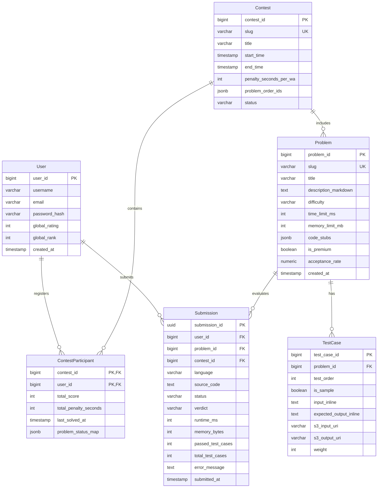
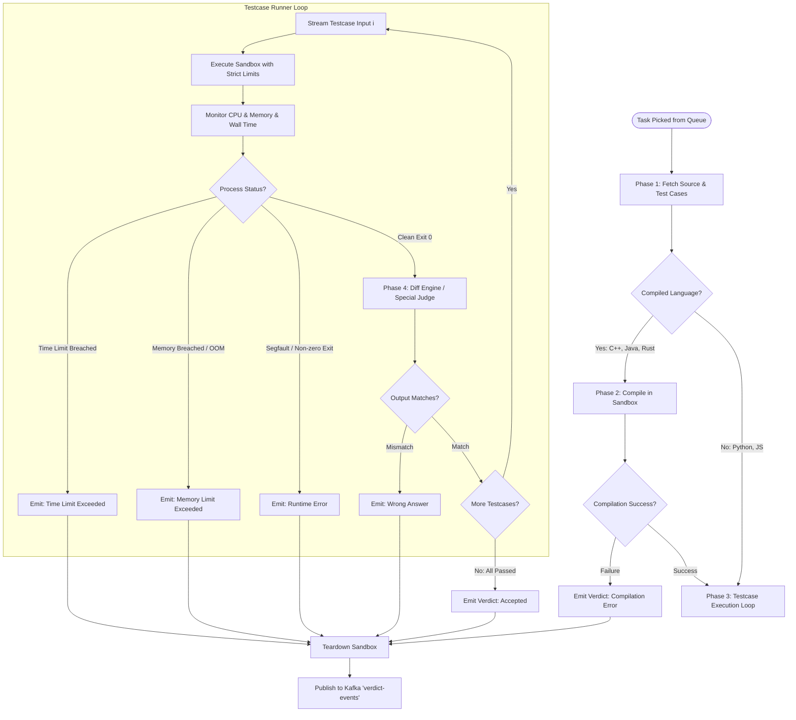

# System Design 26: Design LeetCode / Online Code Judge Platform

> **Source Reference**: [Dodesimo System Design Notes: Design LeetCode](https://github.com/Dodesimo/SystemDesignNotes/blob/main/Questions/Design%20Leetcode.md)  
> **Methodology**: Formatted using the [Master 5-Step Architectural Blueprint](file:///d:/system%20design%20generation/00-system-design-blueprint-pattern.md) (*Interview with Bunny* FAANG standard).  
> **Topic**: Designing a Secure, High-Throughput Online Code Judge, Execution Sandboxing Engine, and Real-Time Competitive Leaderboard Platform (LeetCode, HackerRank, Codeforces).

---

## 1. Step 1: Requirements Gathering & Estimations

### 1.1 Problem Scope & Core Mental Model
An **Online Code Judge System** is a distributed platform that allows hundreds of thousands of concurrent software engineers to browse algorithmic problems, write and dry-run code across diverse programming languages, submit solutions against strict test suites, and compete in real-time timed coding contests.

From an engineering perspective, an online judge presents unique distributed systems challenges that standard CRUD applications do not:
1. **Hostile Multi-Tenancy & Untrusted Code Execution**: Users submit arbitrary, potentially adversarial source code (C++, Java, Python, Go, Rust, JavaScript). The system must execute this untrusted binary without risking host system compromise (kernel exploits, privilege escalation), resource hijacking (cryptomining, DDoS bots), filesystem tampering, or network probing (SSRF).
2. **Strict Hardware & Temporal Boundary Enforcement**: Submissions must be strictly bounded in CPU time (e.g., $\le 1.00\text{ s}$ per test case) and RAM consumption (e.g., $\le 256\text{ MB}$), measured with sub-millisecond precision regardless of noisy neighbor workloads.
3. **Massive Asynchronous Burst Ingestion**: During global coding contests (e.g., LeetCode Weekly Contest), over **100,000+ competitors** submit code simultaneously within concentrated time spikes (e.g., right after contest start and right before deadline).
4. **Sub-100ms Real-Time Leaderboard**: Rapid ingestion of scores with tie-breaker penalty times, computing global rank and contextual "around me" leaderboards for 100k+ concurrent participants.

```
+───────────────────────────────────────────────────────────────────────────────────+
|                         THE ONLINE JUDGE DUAL PATHWAY                             |
|                                                                                   |
|  [ Synchronous Read Path ] ──▶  Problem Catalog & Monaco Editor (~50ms p99)       |
|                                                                                   |
|  [ Asynchronous Execution ] ──▶ Ingestion ─▶ Message Queue ─▶ Judge Sandbox Pool   |
|                                                                │                  |
|                                                                ▼                  |
|  [ Real-Time Contest Path ] ◀── WebSocket Push ◀── Redis ZSET ◀── Verdict Engine  |
+───────────────────────────────────────────────────────────────────────────────────+
```

---

### 1.2 Functional Requirements (FR)

1. **Problem Exploration & Metadata**:
   - Users can list, search, and paginate problems with multi-dimensional filtering (Difficulty: Easy/Medium/Hard, Topics/Tags, Acceptance Rate, Paid/Free status).
   - Retrieve problem statements, markdown descriptions, constraints, examples, and language-specific starter boilerplate code stubs.
2. **Code Runner / Dry Run ("Run Code")**:
   - Execute user code against sample test cases or custom user-provided inputs on-demand without persisting a formal submission record or affecting user/contest statistics.
3. **Solution Submission & Evaluation ("Submit")**:
   - Asynchronously submit solution code across multiple supported languages (C++, Java, Python 3, Go, Rust, TypeScript).
   - Compile (if applicable) and evaluate against hidden test suites (ranging from 50 to 200+ test cases).
   - Return deterministic execution verdicts: `Accepted (AC)`, `Wrong Answer (WA)`, `Time Limit Exceeded (TLE)`, `Memory Limit Exceeded (MLE)`, `Compilation Error (CE)`, `Runtime Error (RE)`, `Output Limit Exceeded (OLE)`.
   - Provide performance diagnostics: Total runtime (ms), memory consumed (MB), runtime/memory percentiles against other submissions, and diff of the first failed test case.
4. **Live Timed Contests & Competitive Leaderboard**:
   - Host synchronized contests (e.g., 90 minutes, 4 algorithmic problems).
   - Compute real-time leaderboard ranked by:
     1. Primary: Highest cumulative score (number of solved problems / points).
     2. Secondary (Tie-breaker): Lowest total penalty time (sum of solve times from contest start + 5-minute penalty per rejected submission prior to solve).
   - Retrieve global top-$K$ rankings and contextual "around me" rankings with pagination.
5. **User Profile & History**:
   - Persist historical submissions, source code snapshots, pass/fail ratios, topic heatmaps, and global contest rating (Elo / Glicko-2).

---

### 1.3 Non-Functional Requirements (NFR)

1. **Hermetic Security & Zero-Trust Isolation**:
   - Complete sandboxing of untrusted code.
   - **Zero Host Access**: No access to the host kernel filesystem, host process table, or hardware devices.
   - **Zero Network Access**: Completely severed external and internal network connectivity (`lo` disabled or blocked) to prevent SSRF, botnet command-and-control, or cloud metadata theft (`169.254.169.254`).
   - **Resource Quotas**: Hard enforcement of CPU quotas, memory limits, disk I/O, process count limits (prevent fork bombs: `:(){ :|:& };:`), and execution timeouts.
2. **Latency Budgets**:
   - Problem view / metadata read: $< 50\text{ ms}$ (p99).
   - Submission ingestion acknowledgement (`202 Accepted` + Ticket ID): $< 100\text{ ms}$ (p99).
   - End-to-end evaluation & verdict turnaround: $< 5\text{ seconds}$ (p95) under normal load; $< 15\text{ seconds}$ under peak contest spikes.
   - Contest Leaderboard query latency: $< 100\text{ ms}$ (p99) for 100,000 active participants.
3. **High Availability & Fault Tolerance**:
   - Platform availability $\ge 99.99\%$.
   - **Durable Ingestion**: Submissions accepted into the queue must never be lost, even during sudden worker crashes or broker failovers.
   - **Idempotency & Retries**: Judge worker crashes during evaluation trigger an automated timeout and requeue to an alternate healthy node without double-counting scores.
4. **Scalability**:
   - Handle steady-state traffic of $200\text{ submissions/sec}$ and burst contest traffic up to **$5,000\text{ submissions/sec}$**.
   - Linearly autoscale judge worker pods based on queue depth.
5. **Consistency Model**:
   - **Submission State & Leaderboard**: Eventual consistency within $< 1\text{ second}$. Contest leaderboard read can lag by 1–2 seconds without degrading user experience, prioritizing high ingestion availability over strict linearizability.
   - **Problem & Solution Catalog**: Read-heavy, heavily cached with cache-aside invalidation upon admin edits.

---

### 1.4 Capacity Estimations (Back-of-the-Envelope Math)

#### 1.4.1 Traffic & Throughput Math
- **User Base**: 5 Million registered users, 500,000 Daily Active Users (DAU).
- **Contest Scale**: 100,000 concurrent participants in a 90-minute competitive contest.
- **Normal Practice Submission Ingestion**:
  - 500,000 DAU $\times$ 10 submissions/day = 5,000,000 submissions/day.
  - Average submission QPS:
    $$\text{QPS}_{\text{avg}} = \frac{5,000,000 \text{ submissions}}{86,400 \text{ sec}} \approx 58 \text{ submissions/sec}$$
  - Peak normal practice QPS: $\approx 250 \text{ submissions/sec}$.
- **Contest Submission Ingestion Burst**:
  - 100,000 participants $\times$ 4 problems $\times$ avg 4 attempts = 1,600,000 contest submissions over 90 minutes (5,400 seconds).
  - Average contest QPS = $\frac{1,600,000}{5,400} \approx 300 \text{ submissions/sec}$.
  - **Extreme Peak Burst**: At contest start (minute 0–10) and problem transitions, users submit code in bursts of **$3,000 \text{ to } 5,000 \text{ submissions/sec}$**.

#### 1.4.2 Compute & Judge Worker Sizing
- **Average Execution Duration per Submission**:
  - Compilation phase (C++, Java, Rust, Go): $\approx 0.5\text{ s}$
  - Test suite runner (avg 50 test cases with fail-fast optimization): $\approx 1.0\text{ s}$
  - Total sandboxed slot duration: $\approx 1.5\text{ seconds}$.
- **Required Concurrent Sandboxed Execution Slots**:
  - Peak burst = $3,000 \text{ submissions/sec} \times 1.5\text{ s} = 4,500 \text{ active execution slots}$.
- **Judge Worker Node Sizing**:
  - Cloud Instance Type: High-compute bare-metal or compute-optimized VMs (e.g., AWS `c6i.16xlarge` with 64 vCPUs, 128 GB RAM, NVMe local SSD).
  - Each sandbox is allocated **2 dedicated vCPUs** (1 for compiler/runner, 1 for monitoring/diffing) and **1 GB RAM**.
  - Capacity per worker node: $\frac{64 \text{ vCPUs}}{2} = 32 \text{ concurrent sandboxed runners}$.
  - Total Worker Fleet Required for Peak Contest:
    $$\text{Worker Nodes} = \frac{4,500 \text{ execution slots}}{32 \text{ slots/node}} \approx 141 \text{ worker instances}$$
  - During off-peak normal hours: Scales down dynamically to $\approx 15 \text{ to } 20 \text{ worker instances}$.

#### 1.4.3 Storage Estimations (5-Year Horizon)
- **Problem Catalog**:
  - 4,000 problems $\times$ 100 KB (statement, markdown, 10 code stubs) $\approx 400\text{ MB}$.
  - Extremely lightweight; fits entirely into memory (Redis / App Pod RAM).
- **Test Cases**:
  - 4,000 problems $\times$ avg 60 test cases $\times$ avg 20 KB (compressed) $\approx 4.8\text{ GB}$.
  - Large edge-case test cases ($N = 2 \times 10^5$ inputs) can reach 5–10 MB each, stored in S3/Object Storage with local worker SSD caching.
- **Submission History**:
  - 5 Million submissions/day $\times$ 365 days $\times$ 5 years $\approx 9.125 \text{ Billion submissions}$.
  - Metadata record (IDs, status, verdict, runtime, memory, timestamps): $\approx 500\text{ bytes}$.
  - Source code payload (avg): $\approx 1.5\text{ KB}$.
  - Total submission record = $2.0\text{ KB}$.
  - Total 5-Year Submission Storage:
    $$\text{Storage} = 9.125 \times 10^9 \times 2.0\text{ KB} \approx 18.25\text{ TB}$$
  - Partitioned across PostgreSQL/Cassandra shards with cold source code archived to object storage (AWS S3 Glacier / Infrequent Access).

#### 1.4.4 Real-Time Leaderboard Memory & Network Math
- 100,000 active participants per contest.
- Redis Sorted Set (ZSET) overhead: $\approx 128\text{ bytes}$ per entry (hash table node + skiplist node + member key).
  $$\text{Memory per Contest ZSET} = 100,000 \times 128\text{ bytes} \approx 12.8\text{ MB}$$
- Even 50 concurrent active contests worldwide require $< 1\text{ GB}$ of Redis RAM.
- **Leaderboard Read Egress Bandwidth**:
  - 100,000 clients polling or streaming updates every 5 seconds = $20,000 \text{ QPS}$.
  - Payload per leaderboard page (Top 50 + user rank): $\approx 3\text{ KB}$.
  - Egress Bandwidth:
    $$\text{Bandwidth} = 20,000 \text{ QPS} \times 3\text{ KB} = 60\text{ MB/s} \approx 480\text{ Mbps}$$

---

## 2. Step 2: Identification of Core Entities & Data Modeling

```
+───────────────────────────────────────────────────────────────────────────────────────────+
|                                ENTITY RELATIONSHIP DIAGRAM                                |
+───────────────────────────────────────────────────────────────────────────────────────────+
|                                                                                           |
|    +──────────────────+           1:N          +─────────────────────+                    |
|    |      User        |───────────────────────▶|     Submission      |                    |
|    +──────────────────+                        +─────────────────────+                    |
|             │                                             │                               |
|             │ 1:N                                         │ M:1                           |
|             ▼                                             ▼                               |
|    +──────────────────+           M:N          +─────────────────────+                    |
|    |ContestParticipant|◀───────────────────────|       Problem       |                    |
|    +──────────────────+                        +─────────────────────+                    |
|             │                                             │                               |
|             │ M:1                                         │ 1:N                           |
|             ▼                                             ▼                               |
|    +──────────────────+                        +─────────────────────+                    |
|    |     Contest      |                        |      TestCase       |                    |
|    +──────────────────+                        +─────────────────────+                    |
|                                                                                           |
+───────────────────────────────────────────────────────────────────────────────────────────+
```

### 2.1 Core Relational Entities & Data Modeling



---

### 2.2 Relational SQL Schemas (PostgreSQL Production Specification)

```sql
-- 1. PROBLEMS TABLE
CREATE TABLE problems (
    problem_id BIGSERIAL PRIMARY KEY,
    slug VARCHAR(128) UNIQUE NOT NULL,
    title VARCHAR(255) NOT NULL,
    description_markdown TEXT NOT NULL,
    difficulty VARCHAR(16) NOT NULL CHECK (difficulty IN ('EASY', 'MEDIUM', 'HARD')),
    time_limit_ms INTEGER NOT NULL DEFAULT 1000,
    memory_limit_mb INTEGER NOT NULL DEFAULT 256,
    code_stubs JSONB NOT NULL, -- e.g. {"cpp": "class Solution...", "python": "class Solution:..."}
    is_premium BOOLEAN NOT NULL DEFAULT FALSE,
    total_submissions BIGINT NOT NULL DEFAULT 0,
    total_accepted BIGINT NOT NULL DEFAULT 0,
    acceptance_rate NUMERIC(5,2) GENERATED ALWAYS AS (
        CASE WHEN total_submissions > 0 THEN (total_accepted::numeric / total_submissions::numeric) * 100.0 ELSE 0.0 END
    ) STORED,
    created_at TIMESTAMPTZ NOT NULL DEFAULT NOW(),
    updated_at TIMESTAMPTZ NOT NULL DEFAULT NOW()
);
CREATE INDEX idx_problems_difficulty ON problems(difficulty);

-- 2. TEST CASES TABLE
CREATE TABLE test_cases (
    test_case_id BIGSERIAL PRIMARY KEY,
    problem_id BIGINT NOT NULL REFERENCES problems(problem_id) ON DELETE CASCADE,
    test_order INT NOT NULL,
    is_sample BOOLEAN NOT NULL DEFAULT FALSE,
    input_inline TEXT,               -- For small test inputs (< 4KB)
    expected_output_inline TEXT,      -- For small test outputs (< 4KB)
    s3_input_uri VARCHAR(512),       -- For large test inputs (S3 URI)
    s3_output_uri VARCHAR(512),      -- For large expected outputs (S3 URI)
    weight INT NOT NULL DEFAULT 1,
    created_at TIMESTAMPTZ NOT NULL DEFAULT NOW(),
    CONSTRAINT uq_problem_test_order UNIQUE(problem_id, test_order)
);
CREATE INDEX idx_test_cases_problem_id ON test_cases(problem_id);

-- 3. SUBMISSIONS TABLE (Partitioned by Year/Month for Horizontal Scale)
CREATE TABLE submissions (
    submission_id UUID NOT NULL DEFAULT gen_random_uuid(),
    user_id BIGINT NOT NULL,
    problem_id BIGINT NOT NULL REFERENCES problems(problem_id),
    contest_id BIGINT,               -- NULL for regular practice submissions
    language VARCHAR(32) NOT NULL,   -- 'cpp', 'java', 'python3', 'golang', 'rust'
    source_code TEXT NOT NULL,
    status VARCHAR(32) NOT NULL DEFAULT 'PENDING' CHECK (status IN ('PENDING', 'RUNNING', 'COMPLETED')),
    verdict VARCHAR(32) NOT NULL DEFAULT 'IN_QUEUE' CHECK (verdict IN (
        'IN_QUEUE', 'COMPILING', 'RUNNING', 'ACCEPTED', 
        'WRONG_ANSWER', 'TIME_LIMIT_EXCEEDED', 'MEMORY_LIMIT_EXCEEDED', 
        'COMPILATION_ERROR', 'RUNTIME_ERROR', 'OUTPUT_LIMIT_EXCEEDED', 'INTERNAL_ERROR'
    )),
    runtime_ms INTEGER,
    memory_bytes BIGINT,
    passed_test_cases INT DEFAULT 0,
    total_test_cases INT DEFAULT 0,
    error_message TEXT,
    submitted_at TIMESTAMPTZ NOT NULL DEFAULT NOW(),
    PRIMARY KEY (submitted_at, submission_id)
) PARTITION BY RANGE (submitted_at);

-- Partition creation example
CREATE TABLE submissions_2026_q4 PARTITION OF submissions
    FOR VALUES FROM ('2026-10-01 00:00:00+00') TO ('2027-01-01 00:00:00+00');
CREATE INDEX idx_submissions_user_problem ON submissions(user_id, problem_id, submitted_at DESC);
CREATE INDEX idx_submissions_contest ON submissions(contest_id, submitted_at DESC) WHERE contest_id IS NOT NULL;

-- 4. CONTESTS TABLE
CREATE TABLE contests (
    contest_id BIGSERIAL PRIMARY KEY,
    slug VARCHAR(128) UNIQUE NOT NULL,
    title VARCHAR(255) NOT NULL,
    start_time TIMESTAMPTZ NOT NULL,
    end_time TIMESTAMPTZ NOT NULL,
    penalty_seconds_per_wa INT NOT NULL DEFAULT 300, -- 5 min penalty
    problem_order_ids JSONB NOT NULL,                -- e.g. [101, 102, 103, 104]
    status VARCHAR(32) NOT NULL DEFAULT 'UPCOMING' CHECK (status IN ('UPCOMING', 'ACTIVE', 'COMPLETED'))
);

-- 5. CONTEST PARTICIPANTS TABLE
CREATE TABLE contest_participants (
    contest_id BIGINT NOT NULL REFERENCES contests(contest_id),
    user_id BIGINT NOT NULL,
    total_score INT NOT NULL DEFAULT 0,
    total_penalty_seconds INT NOT NULL DEFAULT 0,
    last_solved_at TIMESTAMPTZ,
    problem_status_map JSONB NOT NULL DEFAULT '{}'::jsonb,
    -- Schema for problem_status_map:
    -- {
    --   "101": {"status": "AC", "wrong_attempts": 1, "solved_time_sec": 420},
    --   "102": {"status": "WA", "wrong_attempts": 3, "solved_time_sec": null}
    -- }
    PRIMARY KEY (contest_id, user_id)
);
CREATE INDEX idx_contest_participants_ranking ON contest_participants(contest_id, total_score DESC, total_penalty_seconds ASC);
```

---

## 3. Step 3: API & Interface Design

The platform communicates via **HTTP REST** for idempotent metadata and submission ingestion, backed by **WebSockets / Server-Sent Events (SSE)** for streaming execution progress to the browser's Monaco Code Editor.

---

### 3.1 Problem Catalog Endpoints

#### `GET /api/v1/problems`
Retrieve a paginated, filterable catalog of coding problems.

**Query Parameters:**
- `page`: Integer (default: 1)
- `limit`: Integer (default: 50, max: 100)
- `difficulty`: String (`EASY`, `MEDIUM`, `HARD`)
- `tag`: String (e.g., `dynamic-programming`, `graphs`)
- `status`: String (`TODO`, `SOLVED`, `ATTEMPTED`)

**Response (`200 OK`):**
```json
{
  "total": 3450,
  "page": 1,
  "limit": 50,
  "problems": [
    {
      "id": 1,
      "slug": "two-sum",
      "title": "Two Sum",
      "difficulty": "EASY",
      "acceptance_rate": 51.4,
      "is_premium": false,
      "tags": ["Array", "Hash Table"]
    },
    {
      "id": 42,
      "slug": "trapping-rain-water",
      "title": "Trapping Rain Water",
      "difficulty": "HARD",
      "acceptance_rate": 61.2,
      "is_premium": false,
      "tags": ["Array", "Two Pointers", "Dynamic Programming", "Stack"]
    }
  ]
}
```

---

#### `GET /api/v1/problems/{problem_slug}`
Retrieve problem details and starter stubs for the Monaco Editor.

**Query Parameters:**
- `language`: String (optional, e.g., `python3`, `cpp`, defaults to user preference).

**Response (`200 OK`):**
```json
{
  "id": 1,
  "slug": "two-sum",
  "title": "Two Sum",
  "difficulty": "EASY",
  "time_limit_ms": 1000,
  "memory_limit_mb": 256,
  "description_markdown": "# Two Sum\n\nGiven an array of integers `nums` and an integer `target`...",
  "sample_test_cases": [
    {
      "input": "nums = [2,7,11,15], target = 9",
      "expected_output": "[0,1]"
    },
    {
      "input": "nums = [3,2,4], target = 6",
      "expected_output": "[1,2]"
    }
  ],
  "code_stub": "class Solution:\n    def twoSum(self, nums: List[int], target: int) -> List[int]:\n        pass\n"
}
```

---

### 3.2 Code Execution & Submission Endpoints

#### `POST /api/v1/problems/{problem_id}/run` (Dry Run)
Executes user code against sample or custom inputs. Does not create permanent records.

**Request (`POST`):**
```json
{
  "language": "cpp",
  "source_code": "class Solution { public: vector<int> twoSum(vector<int>& nums, int target) { ... } };",
  "custom_input": "nums = [3,3], target = 6"
}
```

**Response (`200 OK`):**
```json
{
  "status": "COMPLETED",
  "verdict": "ACCEPTED",
  "runtime_ms": 4,
  "memory_bytes": 10842000,
  "stdout": "",
  "user_output": "[0,1]",
  "expected_output": "[0,1]"
}
```

---

#### `POST /api/v1/problems/{problem_id}/submit` (Formal Submission)
Asynchronously enqueues a submission for full test-suite evaluation.

**Headers:**
- `Authorization`: `Bearer <jwt_token>`
- `X-Idempotency-Key`: `uuidv4` (prevents double submits on client network stutter)

**Request (`POST`):**
```json
{
  "contest_id": null,
  "language": "python3",
  "source_code": "class Solution:\n    def twoSum(self, nums: List[int], target: int) -> List[int]:\n        lookup = {}\n        for i, n in enumerate(nums):\n            diff = target - n\n            if diff in lookup:\n                return [lookup[diff], i]\n            lookup[n] = i\n        return []"
}
```

**Response (`202 Accepted`):**
```json
{
  "submission_id": "sub_judge_9921a",
  "status": "PENDING",
  "poll_url": "/api/v1/submissions/sub_judge_9921a",
  "websocket_channel": "wss://judge-stream.leetcode.com/ws/v1/submissions/sub_judge_9921a"
}
```

---

#### `GET /api/v1/submissions/{submission_id}` (Polling Fallback)
Retrieves the execution status and verdict.

**Response (`200 OK` when completed):**
```json
{
  "submission_id": "sub_judge_9921a",
  "user_id": 98214,
  "problem_id": 1,
  "status": "COMPLETED",
  "verdict": "ACCEPTED",
  "passed_test_cases": 63,
  "total_test_cases": 63,
  "runtime_ms": 48,
  "runtime_percentile": 89.42,
  "memory_bytes": 17825792,
  "memory_percentile": 72.15,
  "submitted_at": "2026-10-18T14:02:11Z"
}
```

---

### 3.3 Real-Time Contest & Leaderboard Endpoints

#### `GET /api/v1/contests/{contest_id}/leaderboard`
Fetches global rankings and contextual user ranking with sub-100ms response time.

**Query Parameters:**
- `page`: Integer (default: 1)
- `limit`: Integer (default: 50)
- `around_user_id`: Integer (optional; returns page centered around specified user)

**Response (`200 OK`):**
```json
{
  "contest_id": 400,
  "contest_slug": "weekly-contest-400",
  "total_participants": 94812,
  "current_user_rank": 342,
  "leaderboard": [
    {
      "rank": 1,
      "user_id": 41209,
      "username": "tourist",
      "total_score": 18,
      "total_penalty_time": 1942,
      "problem_results": [
        {"problem_id": 101, "status": "AC", "time_sec": 180, "wrong_attempts": 0},
        {"problem_id": 102, "status": "AC", "time_sec": 420, "wrong_attempts": 0},
        {"problem_id": 103, "status": "AC", "time_sec": 840, "wrong_attempts": 0},
        {"problem_id": 104, "status": "AC", "time_sec": 1942, "wrong_attempts": 0}
      ]
    }
  ]
}
```

---

## 4. Step 4: High-Level Architecture

The system is decoupled into an asynchronous, event-driven microservices architecture to isolate compute-intensive, untrusted code execution from latency-sensitive web and catalog requests.

```mermaid
flowchart TD
    subgraph Client Tier
        Browser["Web Browser (Monaco Editor)"]
        Mobile["Mobile / API Client"]
    end

    subgraph Edge Tier
        CDN["Cloudflare CDN (Static Problems, Assets)"]
        WAF["Edge WAF & Rate Limiter"]
        LB["Network Load Balancer (NLB)"]
    end

    subgraph Gateway Tier
        APIGW["API Gateway (Envoy / Kong)"]
        Auth["Auth Service (JWT Validation)"]
    end

    subgraph Application Tier
        ProblemSvc["Problem Catalog Service"]
        SubIngestSvc["Submission Ingestion Service"]
        ContestSvc["Contest & Leaderboard Service"]
        WSServer["WebSocket Gateway (Push Verdicts)"]
    end

    subgraph Messaging & Task Orchestration
        KafkaContest["Kafka: 'contest-submissions' (VIP Priority)"]
        KafkaPractice["Kafka: 'practice-submissions' (Normal)"]
        KafkaVerdict["Kafka: 'verdict-events'"]
    end

    subgraph Judge Worker Fleet
        Worker1["Judge Worker 1 (gVisor / Firecracker)"]
        Worker2["Judge Worker 2 (gVisor / Firecracker)"]
        WorkerN["Judge Worker N (Autoscaled Fleet)"]
    end

    subgraph State & Storage Tier
        ProblemDB[(Problem DB - PostgreSQL + Redis)]
        SubmissionDB[(Submission DB - Partitioned Postgres)]
        RedisLeaderboard[(Redis Cluster - Contest ZSETs)]
        S3TestCases[("AWS S3 / R2 (Large Test Cases & Code)")]
        LocalSSDCache[("Worker Local NVMe SSD (Pre-warmed Test Cases)")]
    end

    %% Ingress Flow
    Browser --> CDN
    Mobile --> CDN
    CDN --> WAF
    WAF --> LB
    LB --> APIGW
    APIGW --> Auth

    %% App Service Routing
    APIGW --> ProblemSvc
    APIGW --> SubIngestSvc
    APIGW --> ContestSvc
    Browser <===>|WebSocket (Live Verdict)| WSServer

    %% Problem Service State
    ProblemSvc --> ProblemDB

    %% Submission Path
    SubIngestSvc -->|Contest Traffic| KafkaContest
    SubIngestSvc -->|Practice Traffic| KafkaPractice
    SubIngestSvc -->|Write Initial Status| SubmissionDB

    %% Worker Execution
    KafkaContest --> Worker1
    KafkaContest --> Worker2
    KafkaPractice --> WorkerN
    Worker1 <--> LocalSSDCache
    Worker2 <--> LocalSSDCache
    LocalSSDCache <-->|Cold Misses| S3TestCases

    %% Verdict Egress
    Worker1 -->|Publish Result| KafkaVerdict
    Worker2 -->|Publish Result| KafkaVerdict
    KafkaVerdict --> ContestSvc
    KafkaVerdict --> WSServer
    KafkaVerdict --> SubmissionDB
    ContestSvc --> RedisLeaderboard
```

### 4.1 Layer Responsibilities & Architectural Flow

1. **Client Tier (Monaco Editor)**:
   - Renders code editor, syntax highlighting, diff viewer, and outputs.
   - Maintains an active bi-directional WebSocket session to stream execution events (`COMPILING` $\to$ `RUNNING_TEST 14/63` $\to$ `ACCEPTED`).
2. **Edge Tier (Cloudflare CDN + WAF)**:
   - Caches static problem statements, boilerplates, and JS/Wasm bundles.
   - Throttles malicious submission spamming via Token Bucket rate limiters (e.g., max 1 submission every 5 seconds per IP/account).
3. **Gateway Tier (Envoy / Kong)**:
   - Performs TLS termination, JWT token verification, and payload size inspection (rejecting code payloads $> 64\text{ KB}$).
4. **Submission Ingestion Service**:
   - Ultra-thin, stateless Golang microservice.
   - Writes submission row as `PENDING` to PostgreSQL.
   - Routes the job to Kafka topics based on priority:
     - `contest-submissions`: High-priority topic with dedicated worker pools.
     - `practice-submissions`: Standard priority.
   - Immediately returns `202 Accepted` with the generated `submission_id` in $< 15\text{ ms}$.
5. **Judge Worker Fleet**:
   - Autoscaled cluster running on bare-metal or KVM-enabled cloud instances.
   - Pulls submissions, compiles code in a locked-down sandbox, streams test case inputs, monitors memory/CPU consumption, and asserts output equivalence.
   - Emits finalized verdicts to the `verdict-events` Kafka topic.
6. **Contest & Leaderboard Service**:
   - Consumes from `verdict-events`. If `contest_id` is present and verdict is `ACCEPTED`, updates the Redis Sorted Set (`ZADD`) with composite score and penalty tie-breaker.
7. **WebSocket Gateway**:
   - Subscribes to Redis Pub/Sub / Kafka `verdict-events` and pushes real-time results directly to the user's active browser session.

---

## 5. Step 5: Low-Level Design & Deep Dives

---

### 5.1 Deep Dive 1: Secure Untrusted Code Execution — Sandboxing & MicroVMs

Executing arbitrary user-submitted code is one of the most perilous challenges in distributed systems. An attacker can submit:
- **Fork Bombs**: `:(){ :|:& };:` to exhaust PID tables and freeze the host OS.
- **Resource Exhaustion**: Allocating gigabytes of heap memory to crash the worker via OOM Killer.
- **Filesystem Tampering**: Reading `/etc/shadow`, scanning `/proc` or `/sys`, or attempting to modify the judge engine binaries.
- **Network Exfiltration**: Opening sockets to connect to command-and-control servers, mine cryptocurrency, or attack AWS metadata endpoints (`http://169.254.169.254`).
- **Kernel Exploits**: Exploiting zero-day Linux kernel vulnerabilities (e.g., Dirty COW) to gain root privileges on the host.

```
+───────────────────────────────────────────────────────────────────────────────────────────+
|                           SANDBOX ISOLATION EVOLUTION                                     |
+───────────────────────────────────────────────────────────────────────────────────────────+
|                                                                                           |
|  1. Standard Docker (runc)       2. gVisor (runsc)            3. Firecracker MicroVM      |
|  [ INSUFFICIENT SECURITY ]       [ APPLICATION KERNEL ]       [ HARDWARE VIRTUALIZATION ] |
|                                                                                           |
|     +-------------------+           +-------------------+         +-------------------+   |
|     |   User Code App   |           |   User Code App   |         |   User Code App   |   |
|     +-------------------+           +-------------------+         +-------------------+   |
|               │                               │                             │             |
|     [ Direct Syscall Surface ]      [ 300+ Syscalls Emulated ]    [ Full Linux Guest OS ] |
|     (300+ Host Syscalls Exposed)    (User-Space Sentry Kernel)    (Dedicated Minimal KVM) |
|               │                               │                             │             |
|               ▼                               ▼                             ▼             |
|     +───────────────────+           +───────────────────+         +───────────────────+   |
|     | Host Linux Kernel |           | Restricted Syscall|         |  KVM Hypervisor   |   |
|     | (Shared & At Risk)|           | (Host Kernel Safe)|         | (Hardware Isolated|   |
|     +───────────────────+           +───────────────────+         +───────────────────+   |
|                                                                                           |
+───────────────────────────────────────────────────────────────────────────────────────────+
```

#### Why Plain Docker (`runc`) is Unsafe for Online Judges
Standard Docker containers share the host Linux kernel directly. While namespaces (`pid`, `net`, `mnt`, `ipc`) provide process separation, the entire syscall interface remains accessible. If an attacker triggers a kernel bug or privilege escalation vulnerability, they gain unrestricted access to the underlying host node and all other users' code executing on that node.

#### Modern Production Solutions

##### Option A: Google gVisor (`runsc`) — The Production Standard for LeetCode
- **Mechanism**: gVisor implements a user-space virtual kernel called **Sentry**. When the user application makes a syscall (e.g., `open`, `read`, `mmap`), it is intercepted by Sentry in user space. Sentry handles the request itself and never forwards the raw syscall to the host kernel.
- **Security Boundary**: The host kernel syscall surface is reduced from $350+$ syscalls to fewer than $40$ highly vetted syscalls managed by the **Gofer** file proxy.
- **Performance**: Near-zero startup latency ($< 30\text{ ms}$), light memory footprint ($\approx 15\text{ MB}$ overhead), ideal for fast ephemeral algorithmic runners.

##### Option B: AWS Firecracker (MicroVMs)
- **Mechanism**: Minimalist, Rust-based Virtual Machine Monitor using Linux KVM (Kernel-based Virtual Machine). Boots an independent, minimal Linux guest kernel per submission.
- **Security Boundary**: Full hardware-assisted virtualization. Even complete root compromise inside the guest VM cannot escape the KVM hardware perimeter.
- **Performance**: Cold boot in $\approx 5\text{ to } 10\text{ ms}$, memory footprint $\approx 5\text{ MB}$ per microVM.

#### Multi-Layer Defense-in-Depth Implementation

Every sandbox runner applies **four rigid isolation layers**:

```
Layer 1: Linux Namespaces & Network Isolation (ip netns: zero external routes, no network device)
Layer 2: cgroups v2 (Strict CPU, Memory, and PID Quotas)
Layer 3: seccomp-bpf (Syscall Whitelist Filtering)
Layer 4: Chroot / Read-Only tmpfs Mount (Ephemeral, in-memory filesystem with 10MB quota)
```

```c
// Example: seccomp-bpf Linux Syscall Whitelist for Judge Sandbox Runner
#include <seccomp.h>
#include <sys/prctl.h>
#include <fcntl.h>

void apply_strict_seccomp_filter() {
    // 1. Initialize seccomp context with default KILL action for any unauthorized syscall
    scmp_filter_ctx ctx = seccomp_init(SCMP_ACT_KILL_PROCESS);

    // 2. Whitelist ONLY essential algorithmic execution syscalls
    seccomp_rule_add(ctx, SCMP_ACT_ALLOW, SCMP_SYS(read), 0);
    seccomp_rule_add(ctx, SCMP_ACT_ALLOW, SCMP_SYS(write), 0);
    seccomp_rule_add(ctx, SCMP_ACT_ALLOW, SCMP_SYS(exit_group), 0);
    seccomp_rule_add(ctx, SCMP_ACT_ALLOW, SCMP_SYS(brk), 0);
    seccomp_rule_add(ctx, SCMP_ACT_ALLOW, SCMP_SYS(mmap), 0);
    seccomp_rule_add(ctx, SCMP_ACT_ALLOW, SCMP_SYS(munmap), 0);
    seccomp_rule_add(ctx, SCMP_ACT_ALLOW, SCMP_SYS(fstat), 0);
    seccomp_rule_add(ctx, SCMP_ACT_ALLOW, SCMP_SYS(clock_gettime), 0);

    // 3. EXPLICITLY DENY dangerous network and process-spawning syscalls
    // (Implicitly killed, but codified for auditability)
    seccomp_rule_add(ctx, SCMP_ACT_KILL, SCMP_SYS(socket), 0);
    seccomp_rule_add(ctx, SCMP_ACT_KILL, SCMP_SYS(connect), 0);
    seccomp_rule_add(ctx, SCMP_ACT_KILL, SCMP_SYS(fork), 0);
    seccomp_rule_add(ctx, SCMP_ACT_KILL, SCMP_SYS(clone), 0);
    seccomp_rule_add(ctx, SCMP_ACT_KILL, SCMP_SYS(execve), 0);

    // 4. Load filter into Linux kernel
    seccomp_load(ctx);
    seccomp_release(ctx);
}
```

```bash
# Linux cgroups v2 Hard Resource Quota Setup
CGROUP_PATH="/sys/fs/cgroup/judge_sandbox_${SUBMISSION_ID}"
mkdir -p ${CGROUP_PATH}

# Hard Memory Limit: 256MB + zero swap (kills instantly via OOM on breach)
echo "268435456" > ${CGROUP_PATH}/memory.max
echo "0" > ${CGROUP_PATH}/memory.swap.max

# Strict CPU Quota: Max 1 core utilization (100000us per 100000us window)
echo "100000 100000" > ${CGROUP_PATH}/cpu.max

# Strict PID Limit: Exactly 1 process (stops fork bombs dead)
echo "1" > ${CGROUP_PATH}/pids.max
```

---

### 5.2 Deep Dive 2: Judge Worker Orchestration & Execution Verdict Engine

The execution pipeline processes user code through distinct stages, applying fail-fast optimizations to conserve compute resources.



#### Detailed Execution Verdicts & Linux Signal Mapping

| Verdict | Acronym | Trigger Condition / Detection Mechanism | Exit / Signal Code |
| :--- | :--- | :--- | :--- |
| **Accepted** | `AC` | Code outputs exact expected tokens for **all** test cases within time & memory limits. | Exit Code `0` |
| **Wrong Answer** | `WA` | Program ran cleanly, but stdout tokens mismatched expected output file. | Exit Code `0` (diff failure) |
| **Time Limit Exceeded** | `TLE` | Process CPU cycles or wall-clock timer exceeded `time_limit_ms`. Enforced via `setitimer` and `SIGXCPU` / `SIGKILL`. | Signal `SIGXCPU` (24) / `SIGKILL` (9) |
| **Memory Limit Exceeded** | `MLE` | Heap allocation breached `memory_limit_mb`. Enforced via cgroups `memory.max` or `setrlimit(RLIMIT_AS)`. | `OOM-Killed` (Exit 137) |
| **Compilation Error** | `CE` | Compiler (`g++`, `javac`, `rustc`) returned non-zero exit code with compiler diagnostics. | Compiler Exit $\ne 0$ |
| **Runtime Error** | `RE` | Segfault (null pointer, out-of-bounds), division by zero, unhandled exception. | `SIGSEGV` (11), `SIGFPE` (8), Exit $> 0$ |
| **Output Limit Exceeded**| `OLE`| Program emitted infinite log stream (e.g., printed $> 8\text{ MB}$ to stdout). | `SIGXFSZ` (25) |

#### Fail-Fast Evaluation Strategy
Instead of executing all 100 test cases for a broken submission, the test runner evaluates test cases sequentially. The moment a test case fails with `WA`, `TLE`, `MLE`, or `RE`, execution **aborts immediately**. 
- *Impact*: In real-world coding contests, $> 65\%$ of submissions contain bugs or suboptimal algorithmic complexities (e.g., $O(N^2)$ solution for $N=10^5$). Fail-fast saves over **$70\%$ of judge compute cycles**, maintaining queue throughput under heavy contest loads.

#### Special Judge (Checker) Architecture
For problems where multiple correct answers exist (e.g., floating-point answers requiring $\epsilon \le 10^{-5}$, graph topological sorts, or "return any valid permutation"):
- Instead of exact string diffing, a problem-specific compiled **Checker Program** evaluates the output:
  ```bash
  ./checker input.txt user_output.txt expected_output.txt
  ```
- The checker reads the user output, verifies structural validity against the input, and returns `0` for valid, `1` for invalid.

---

### 5.3 Deep Dive 3: Real-Time Contest Leaderboard Engine

During a live contest with **100,000 active participants**, participants refresh leaderboards constantly. Running SQL queries with `COUNT()`, `SUM()`, and `ORDER BY` across millions of submission records will immediately collapse relational databases.

```
+───────────────────────────────────────────────────────────────────────────────────────────+
|                  REDIS COMPOSITE SCORE ENCODING FOR CONTEST RANKING                       |
+───────────────────────────────────────────────────────────────────────────────────────────+
|                                                                                           |
|  Goal: Rank primarily by Problems Solved (DESC), secondarily by Penalty Time (ASC).       |
|                                                                                           |
|  IEEE 754 64-bit Double Precision Mantissa provides 53 bits (9,007,199,254,740,992).      |
|                                                                                           |
|          [ 4 Decimal Digits ]       .       [ 8 Decimal Digits ]                          |
|         Problems Solved (0 - 4)     .     (MAX_PENALTY - Actual Penalty)                  |
|                                                                                           |
|  Example 1: Solved 3 problems in 1,200 seconds (Penalty = 1200s, MAX = 99,999,999s)       |
|             Fractional Part = 99,999,999 - 1,200 = 99998799                               |
|             Redis Score = 3.99998799                                                      |
|                                                                                           |
|  Example 2: Solved 3 problems in 3,600 seconds (Penalty = 3600s)                          |
|             Fractional Part = 99,999,999 - 3,600 = 99996399                               |
|             Redis Score = 3.99996399                                                      |
|                                                                                           |
|  Result: Higher Redis Score = Higher Rank (3.99998799 > 3.99996399)!                      |
|                                                                                           |
+───────────────────────────────────────────────────────────────────────────────────────────+
```

#### Redis Sorted Set (ZSET) Scoring Mechanics
Redis ZSETs maintain an in-memory **SkipList + Hash Table**, providing $O(\log N)$ insertions, updates, and rank lookups.

To achieve single-key sorting where **higher score wins** and **lower penalty time wins**, we pack both dimensions into a single floating-point number:

$$\text{RedisScore} = \text{ProblemsSolved} + \left( \frac{\text{MAX\_PENALTY} - \text{PenaltySeconds}}{\text{MAX\_PENALTY}} \right)$$

Where $\text{MAX\_PENALTY} = 100,000 \text{ seconds}$ (well exceeding standard 90-minute contests = 5,400s).

#### Atomic Leaderboard Update via Redis Lua Script
When an `ACCEPTED` verdict arrives from the judge worker, the contest service executes an atomic Lua script to update the participant's score, penalty time, and ZSET rank without race conditions:

```lua
-- Atomic Contest Score & Rank Update (update_contest_rank.lua)
-- KEYS[1]: contest:leaderboard:{contest_id}
-- KEYS[2]: contest:participant_data:{contest_id}
-- ARGV[1]: user_id
-- ARGV[2]: problem_id
-- ARGV[3]: solve_time_seconds
-- ARGV[4]: penalty_increment_seconds

local contest_zset = KEYS[1]
local user_data_hash = KEYS[2]
local user_id = ARGV[1]
local problem_id = ARGV[2]
local solve_time = tonumber(ARGV[3])
local penalty_inc = tonumber(ARGV[4])

-- 1. Check if problem was already solved
local user_key = user_id .. ":" .. problem_id
local already_solved = redis.call('HGET', user_data_hash, user_key .. ":solved")
if already_solved == "1" then
    return 0 -- Already solved, do not update score or penalty
end

-- 2. Mark problem as solved and record attempts
redis.call('HSET', user_data_hash, user_key .. ":solved", "1")
local wrong_attempts = tonumber(redis.call('HGET', user_data_hash, user_key .. ":wrong") or "0")

-- 3. Calculate penalty time (Submission solve time + 300s per wrong attempt)
local problem_penalty = solve_time + (wrong_attempts * penalty_inc)

-- 4. Update cumulative user stats
local current_solved = redis.call('HINCRBY', user_data_hash, user_id .. ":total_solved", 1)
local current_penalty = redis.call('HINCRBY', user_data_hash, user_id .. ":total_penalty", problem_penalty)

-- 5. Calculate composite Redis score: Solved + (10000000 - penalty) / 10000000
local max_penalty = 10000000
local tie_breaker = (max_penalty - current_penalty) / max_penalty
local final_score = current_solved + tie_breaker

-- 6. Update Redis Sorted Set
redis.call('ZADD', contest_zset, final_score, user_id)

return final_score
```

#### Low-Latency Leaderboard Queries

```text
1. Fetch Global Top 50 (O(log N + M) = < 1ms):
   ZREVRANGE contest:leaderboard:400 0 49 WITHSCORES

2. Fetch Current User Exact Global Rank (O(log N) = < 1ms):
   ZREVRANK contest:leaderboard:400 "user:98214"
   (Returns 0-indexed rank; add 1 for display)

3. Fetch "Around Me" Leaderboard (User at rank 342, fetch ranks 337 to 347):
   user_rank = ZREVRANK contest:leaderboard:400 "user:98214"
   start_rank = max(0, user_rank - 5)
   end_rank = user_rank + 5
   ZREVRANGE contest:leaderboard:400 start_rank end_rank WITHSCORES
```

---

### 5.4 Deep Dive 4: Test Case Storage, Distribution & Caching

A major bottleneck in code judges is disk I/O latency when loading large test cases. If an algorithm problem contains 80 test cases, reading 50 MB of data from a remote network store on every single user submission causes catastrophic delays.

```
+───────────────────────────────────────────────────────────────────────────────────────────+
|                           TEST CASE TIERED STORAGE PIPELINE                               |
+───────────────────────────────────────────────────────────────────────────────────────────+
|                                                                                           |
|  [ AWS S3 / Cloudflare R2 ]  ──▶ Canonical durable store (Gzip compressed test suites)     |
|              │                                                                            |
|              ▼                                                                            |
|  [ Worker Local NVMe SSD ]   ──▶ Local directory: /var/cache/judge/testcases/{problem_id}  |
|              │                   (LRU Cache invalidation on problem update)               |
|              ▼                                                                            |
|  [ In-Memory RAM (tmpfs) ]   ──▶ Hot Contest Problems mounted directly in memory          |
|                                  Zero Disk I/O during 100k-user competitions              |
+───────────────────────────────────────────────────────────────────────────────────────────+
```

1. **Pre-Warming Contest Test Cases**:
   - 15 minutes before a weekly contest begins, the orchestrator issues a cluster broadcast command to all 140+ active judge worker nodes.
   - Workers download the 4 contest problem test cases from S3, decompress them, and mount them directly into **in-memory RAM drives (`tmpfs`)** at `/dev/shm/contest_{id}/`.
   - Result: During the entire 90-minute contest, test case inputs are piped to the sandboxes with zero network calls and zero physical disk reads.
2. **Streaming Execution (Piping vs. Buffering)**:
   - For large test cases ($N = 2 \times 10^5$, file size $\approx 10\text{ MB}$), input files are **streamed directly into the sandbox process via Unix pipes (`stdin`)** rather than reading the entire file into memory as a string.
   - The user program processes input iteratively, drastically minimizing judge worker memory overhead.

---

### 5.5 Deep Dive 5: Language-Specific Compilers & Runtimes

Different programming languages require specialized runtime setups:

```
+───────────────────────────────────────────────────────────────────────────────────────────+
|                      COMPILATION & RUNTIME SPECIALIZATION MATRIX                          |
+───────────────────────────────────────────────────────────────────────────────────────────+
| Language   | Compiler / Runtime Flags                     | Execution Command             |
|:-----------|:---------------------------------------------|:------------------------------|
| **C++20**  | g++ -O3 -std=c++20 -DONLINE_JUDGE solution.cpp| ./solution < in.txt           |
| **Java 21**| javac -J-Xms64m -J-Xmx256m Solution.java    | java -Xss64m -Xmx256m Solution|
| **Python3**| python3 -m py_compile solution.py           | pypy3 / python3 solution.py   |
| **Go**     | go build -ldflags="-s -w" -o solution .      | ./solution                     |
| **Rust**   | rustc -O --edition=2021 solution.rs          | ./solution                     |
+───────────────────────────────────────────────────────────────────────────────────────────+
```

- **Java Warm JVMs / Ahead-of-Time (AOT) Compilation**:
  - The standard JVM startup time (class loading, JIT compilation) takes 150–300 ms, which can unfairly penalize Java submissions under strict 1.0s time limits.
  - Production platforms use **GraalVM Native Image** to compile Java ahead-of-time into native binaries, or subtract a standardized **JVM startup baseline constant** ($\approx 150\text{ ms}$) from the measured runtime.
- **Python / PyPy**:
  - Python uses PyPy3 for JIT acceleration where supported, running with `-u` (unbuffered binary stdout) to prevent output buffering delays.

---

## 6. Step 6: Comparative Trade-Off Matrix

| Architectural Dimension | Chosen Strategy | Alternative Considered | Trade-Off & Justification |
| :--- | :--- | :--- | :--- |
| **Untrusted Code Sandboxing** | **gVisor (`runsc`) user-space kernel** | Plain Docker (`runc`) / Bare Linux | Plain Docker shares host kernel; a single kernel exploit gives root host access. gVisor intercepts all syscalls in user space, providing near-VM security with $< 30\text{ ms}$ container boot times. |
| **MicroVM Hypervisor** | **Firecracker MicroVMs** | Full QEMU / VirtualBox | QEMU boots full legacy device models taking seconds and hundreds of MBs. Firecracker strips all legacy devices, booting an isolated minimal Linux kernel via KVM in $< 10\text{ ms}$ with only 5MB RAM overhead. |
| **Submission Ingestion** | **Asynchronous Broker (Kafka / RabbitMQ)** | Synchronous HTTP Request-Response | Synchronous execution blocks web threads for 1–5s, causing connection pool exhaustion and catastrophic cascading failures during 5,000 QPS contest spikes. Async ingestion yields $< 15\text{ ms}$ API responses. |
| **Contest Leaderboard Store** | **Redis Sorted Sets (ZSET) + SkipList** | Relational DB (`ORDER BY score DESC`) | Relational sorting over 100k rows with frequent updates triggers table locks, high disk I/O, and multi-second latencies. Redis ZSET handles updates and rank lookups in $O(\log N)$ ($< 1\text{ ms}$) entirely in RAM. |
| **Score / Tie-Breaker Encoding** | **IEEE 754 Floating-Point Composite Score** | Multi-column SQL Index / Secondary DB | Storing `Score + (MAX - Penalty) / MAX` inside a single 64-bit float allows Redis to natively order participants with zero secondary lookups or complex multi-key coordination. |
| **Test Case Evaluation Mode** | **Fail-Fast (Abort on First Error)** | Run All Test Cases Exhaustively | Running all 100 test cases for broken code wastes $> 70\%$ of judge CPU cycles. Aborting on the first non-accepted test case maximizes throughput during high-stakes contest bursts. |
| **Test Case Storage Tiering** | **S3 Canonical Store + Worker Local NVMe / tmpfs** | Direct Remote Streaming from S3/NFS | Reading 50MB test cases across network mounts on every submission introduces unpredictable latency jitter and network saturation. Pre-warming test cases into worker NVMe/RAM ensures sub-millisecond I/O. |
| **Real-Time Client Updates** | **WebSockets via Dedicated Gateway** | Client Long-Polling | Long-polling generates tens of thousands of redundant HTTP handshakes and database queries. Persistent WebSockets allow instant push notifications as soon as the judge worker publishes the verdict. |

---

## 7. Operational Resilience & Edge Cases

### 7.1 Malicious Attack Scenarios & Mitigations
1. **Fork Bombs (`:(){ :|:& };:`)**:
   - *Mitigation*: Hard Linux cgroups v2 `pids.max = 1`. Any invocation of `fork()` or `clone()` immediately fails with `EAGAIN` or terminates the sandbox via `SIGKILL`.
2. **Infinite Loops (`while(true);`)**:
   - *Mitigation*: Worker sets a dual hardware timer:
     1. Kernel CPU timer via `setrlimit(RLIMIT_CPU, time_limit)`. Kernel raises `SIGXCPU` when user CPU cycles expire.
     2. Watchdog thread on the host measuring wall-clock time. If process hangs (e.g. in uninterruptible sleep), host forcefully executes `kill -9` (`SIGKILL`).
3. **Memory Squeeze / Allocation Loops (`vector<int> v; while(1) v.push_back(1);`)**:
   - *Mitigation*: cgroups `memory.max = 256MB` and `memory.swap.max = 0`. The Linux kernel OOM Killer immediately terminates the sandbox container. Worker detects exit code `137` and tags verdict as `Memory Limit Exceeded (MLE)`.
4. **Network Scanning / SSRF to Cloud Metadata (`curl http://169.254.169.254`)**:
   - *Mitigation*: Unshare network namespace (`CLONE_NEWNET`). The sandbox is created with **no network devices** except a disabled loopback (`lo`). Network syscalls (`socket`, `connect`) are additionally blocked by seccomp-bpf.

### 7.2 Worker Node Crash During Active Execution
- **Hazard**: A judge worker physically crashes or suffers a hardware kernel panic while running submission `sub_8819`.
- **Resolution**:
  - The message broker (Kafka / RabbitMQ) uses **explicit manual acknowledgements**.
  - A message is only acknowledged (`ACK`) *after* the verdict has been written to the `verdict-events` topic.
  - If the worker disconnects or heartbeats expire (e.g., via visibility timeout of 30 seconds), the broker automatically re-delivers the submission task to a healthy worker node.
  - Submissions maintain an `attempt_count` in Redis. If a submission crashes workers $\ge 3$ times (e.g., crafted payload causing host kernel panic), it is permanently moved to a Dead Letter Queue (DLQ) and assigned verdict `INTERNAL_ERROR` for engineer review.

---

## Summary Architecture Scorecard

```
+───────────────────────────────────────────────+───────────────────────────────────────────+
| Requirement Metric                            | Architectural Solution                    |
+───────────────────────────────────────────────+───────────────────────────────────────────+
| Untrusted Code Security                       | gVisor runsc / Firecracker MicroVMs       |
| Contest Scale (100k Concurrent Competitors)   | Priority Kafka Queues + 140+ Judge Workers|
| Leaderboard Query Latency (< 100ms p99)       | Redis ZSET Composite Score (SkipList)     |
| Real-Time Result Streaming                    | Push-based WebSockets via Gateway         |
| Test Case I/O Latency                         | In-Memory tmpfs / Local Worker NVMe Cache |
| Resource Guardrails                           | Linux cgroups v2 + seccomp-bpf            |
+───────────────────────────────────────────────+───────────────────────────────────────────+
```
